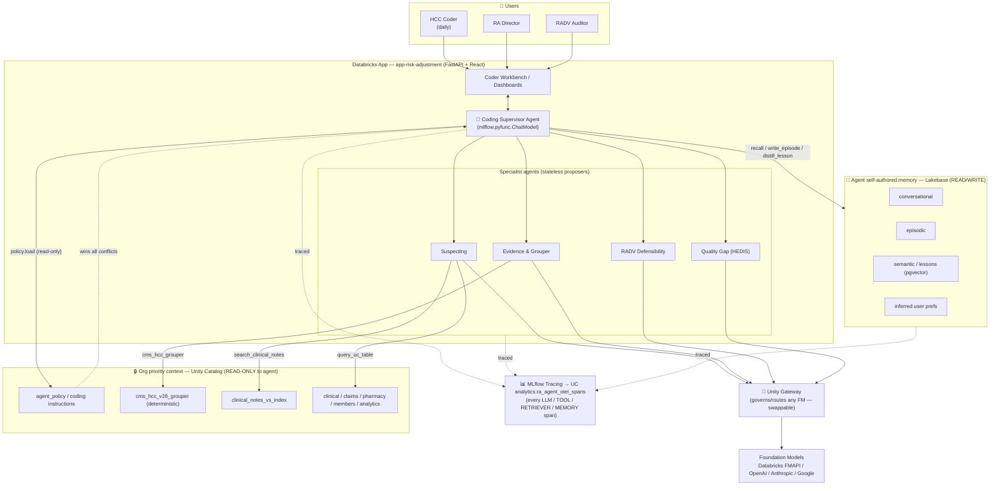
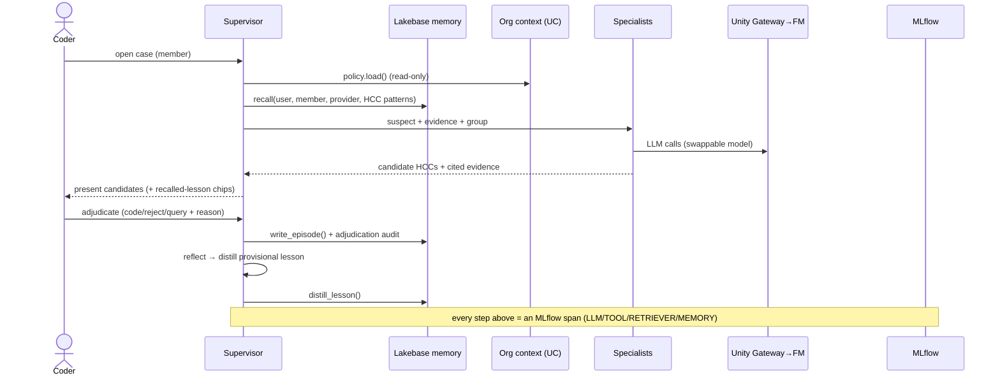

# Risk Adjustment & HCC Intelligence — Build Design Doc

> **Red Bricks Insurance — App #7 (`app-risk-adjustment`)**
> Status: **DESIGN / PLAN** (nothing built yet). This doc is the source-of-truth for the build.
> Audience: internal (SA build reference) + customer-facing architecture narrative for Blues / Medicare Advantage plans.

---

## 0. One-paragraph summary

A payer-side **Risk Adjustment & HCC** app that puts a certified HCC coder in front of an AI that reads the unstructured clinical chart, surfaces **suspected HCCs with evidence citations**, and lets the coder adjudicate (code / reject) — with the organization's coding policy as **read-only, authoritative context** and the agent keeping its **own** memory (what happened on each case, lessons it distills, this coder's standing preferences) in **Lakebase**, so it measurably improves across cases. Every LLM call, tool call, retrieval, and memory read/write is wrapped in **MLflow tracing** to Unity Catalog. The underlying foundation model is swappable across any provider via **Unity Gateway** without touching agent code. Stars/HEDIS gap-closure is folded in as a second module over the same retrieved chart.

This is the app that fixes Red Bricks' weakest spot vs. the provider-side "Brick Health" estate: **GenAI over unstructured clinical text, with a self-improving agentic loop and governed memory.**

---

## 1. Positioning & scope

### 1.1 Why this app
- **Highest-dollar payer workflow.** RAF accuracy drives CMS capitation revenue directly. For a 200K-member MA plan at ~1.25 avg RAF and ~$15K capitation, total risk-adjusted revenue is ~$3.75B — a 0.02 RAF swing is material. *(Illustrative; confidence: moderate.)*
- **The AI story Red Bricks is missing.** Your other agents (FWA, PA) query structured UC tables. This one reads the **chart** — the unstructured note — which is the demo moment a Blues RA/coding audience leans into.
- **Compliance-native.** The same workflow carries real RADV (Risk Adjustment Data Validation) audit exposure, which lets us showcase PHI masking, lineage, human-in-the-loop, and full traceability as *features*, not slideware.

### 1.2 Scope decision — fold Stars/HEDIS in (fold ≠ merge)
**Decision: include a Stars/HEDIS quality module, orchestrated alongside RA, but kept logically separate.** (Confidence: moderate-high, from how Blues-scale plans actually organize chart operations.)

- **Why fold:** RA and HEDIS already share the *same chart chase*. One retrieved diabetic chart serves both the RA coder (diabetes-with-complications HCC) and the HEDIS auditor (A1C gap closure). Mirroring that "one chart, two purposes" reality is the differentiated story: **one platform for chart-driven revenue + quality**, vs. fragmented tools.
- **Why not merge:** HEDIS measure logic, NCQA submission format, and Stars financial modeling are distinct from HCC grouping and RAPS/EDPS submission. Keep them as separate modules sharing member search, the chart/document viewer, and the orchestration layer — separate dashboards, common data layer.
- **Phasing:** RA coder workbench ships first (MVP). HEDIS gap module and RADV defensibility workbench are Phase 2.

---

## 2. Personas (researched) and how they function

| # | Persona | Title(s) | Hands-on? | Primary surface | The decision they make |
|---|---------|----------|-----------|-----------------|------------------------|
| A | **HCC Coder** | CPC / RHIT / Risk-Adjustment Specialist | **Daily, high-volume** (50–100 charts/day) | **Coder Workbench** | "Is this diagnosis documented strongly enough to submit to CMS without RADV risk?" (code / don't code) |
| B | **RA Program Director** | Dir. Risk Adjustment, VP Clinical Coding | Daily via reports | **Program Dashboard** | "Is this batch audit-ready? Where's capture lagging? Do we staff up?" |
| C | **RADV / Compliance Auditor** | RADV Auditor, Clinical Auditor | **Episodic, high-stakes** | **RADV Audit Workbench** | "Is this chart defensible in a CMS audit? What needs remediation?" |
| D | **CDI / Provider Engagement Lead** | Dir. CDI, Provider Relations | Intermittent | **Exception Reports** | "Which providers' documentation trends are problematic? Escalate training?" |
| E | **Chief Actuary / Finance** | CAO / CFO | Monthly, read-only | **RAF→Revenue KPI view** | "What's our competitive RAF position? Invest more in coding/documentation?" |

**How the daily user (A) functions** — the app is built around this loop:
1. Pull next member/case from the chart-chase queue.
2. Open the chart (unstructured notes, problem list, labs, pharmacy, prior claims).
3. The **Suspecting agent** surfaces candidate HCCs, each with a **cited evidence passage**.
4. Coder reviews each candidate → **adjudicates**: *Code* (accept), *Reject*, or *Query provider* (route to CDI, persona D).
5. Accepted HCCs flow to a **RAPS/EDPS** export; the member's RAF delta updates.
6. On the same chart, the **HEDIS tab** shows quality gaps the chart can close.

Guardrail: the AI is **advisory/triage only**. The coder is always the final arbiter, and high-value HCCs (e.g., metastatic cancer, CHF with low EF) require explicit sign-off with the cited chart passage. See §7.4.

---

## 3. The RA/HCC workflow the app automates

```
SUSPECT ──► CHART CHASE ──► CODER REVIEW / ADJUDICATE ──► RAPS/EDPS SUBMIT ──► RADV DEFENSE
(signals:   (retrieve 24mo   (evidence? clinically     (member+HCC list,    (CMS samples ~charts;
 age, Rx,    provider records)  reasonable? maps to      ICD-10→HCC)          is each HCC in the
 claims)                        HCC under V28?)                                chart? defect→recovery)
```

- **Suspecting** = clinical signals (age + claim history + pharmacy) that a member *likely* has an undocumented HCC (e.g., statin + age 70 + prior cardiology claim → suspect CAD).
- **Prospective** (Jan–Oct), **concurrent** (Oct–Dec, year-end push), **retrospective** (post-12/31 through ~late Feb) coding windows.
- **RADV defect types:** unsupported diagnosis (claimed, not in chart), incorrect grouping, clinical inconsistency. Confirmed defects → payment recovery; elevated defect rates → sanction/reputational exposure. This is why **defensibility is a first-class feature**, not an afterthought.

---

## 4. CMS-HCC V28 / RAF primer (verify before customer use)

- **RAF (Risk Adjustment Factor)** = sum of a member's HCC values (+ demographic factors). Plan revenue ≈ Σ(member RAF) × capitation rate.
- **CMS-HCC V28** is the current model, **phasing in over PY2024→PY2026** as a blend with V24. Best-known phase-in: **PY2024 ≈ 33% V28 / 67% V24, PY2025 ≈ 67% / 33%, PY2026 ≈ 100% V28.** **⚠ Confidence: moderate — verify the exact blend and any PY2027/V29 plans against the current CMS Rate Announcement before putting this in front of a customer.**
- V28 increased clinical specificity (diabetes by complication, heart failure by EF, cancer by metastasis status) and changed interaction rules — so the **same diagnosis can map to different HCCs depending on comorbidities**. This is exactly why grouping must be **deterministic**, not left to an LLM (§7.4).

---

## 5. App surfaces
> Build: **Phase 5** (§19).

| Surface | Persona | Contents |
|---------|---------|----------|
| **Coder Workbench** (primary) | A | Case queue → chart/document viewer → AI-suspected HCCs with cited evidence → adjudication controls → RAF-delta meter → RAPS/EDPS export → HEDIS tab → **Unity Gateway model dropdown** (§6.1) |
| **Program Dashboard** | B | HCC capture rate, RAF impact, coder QA/accuracy, RADV risk flags, chart-chase SLA, HEDIS overlap, AI-assist acceptance rate |
| **RADV Audit Workbench** | C | Sampled charts, AI defensibility score + rationale, defect classification, evidence-defense note-taking |
| **Exception Reports** | D | Provider-level documentation-gap rollups ("10 diabetic members from Provider X lack complication documentation") |
| **RAF → Revenue view** | E | Monthly RAF trend, benchmark deltas, revenue-impact model (read-only) |

---

## 6. Model flexibility via Unity Gateway (provider-agnostic FMAPI)

**Requirement:** swap the underlying foundation model across *any* provider the user picks — Databricks-hosted FM APIs or external (OpenAI / Anthropic / Google / Bedrock) — **without changing agent code**.

- **Unity Gateway** (GA; the current name — formerly "Mosaic AI Gateway") governs and routes all model traffic: rate limiting, usage/budget tracking, **payload/inference-table logging to UC**, PII masking, guardrails, provider routing.
- **Pattern:** every model the agent uses is referenced by a **config-driven endpoint name** (env var), called through an **OpenAI-compatible client** pointed at the Databricks serving endpoint. Changing the model = changing the endpoint name in `app.yml` / agent config. No code change.

```python
# agent config (env-driven; no hard-coded provider)
MODELS = {
    "suspecting":   os.environ["RA_SUSPECTING_ENDPOINT"],    # e.g. databricks-claude-haiku-4-5
    "evidence":     os.environ["RA_EVIDENCE_ENDPOINT"],      # e.g. databricks-llama-4-maverick
    "reflection":   os.environ["RA_REFLECTION_ENDPOINT"],    # e.g. an external GPT endpoint via Unity Gateway
}
# all three resolve to Unity-Gateway-governed serving endpoints; swap freely.
```

- Endpoints are declared as app `resources` (`serving_endpoint` + `CAN_QUERY`) following the repo's `ai_gateway.yml` convention, so governance/logging is automatic.

### 6.1 Model selector dropdown (per-request override)
The app surfaces a **model dropdown** so a user can pick any Unity-Gateway model at runtime. The agent reads a per-request override from `params.custom_inputs.model_endpoint` (falls back to configured default), so switching models is a UI action with **no redeploy**. The app exposes the allowed list (a curated subset of the workspace's FM endpoints) via a `GET /api/models` route (Phase 5). Verified live against `databricks-claude-sonnet-5`.

### 6.2 Gateway quirks learned (build notes)
- **Claude 5 family rejects the `temperature` parameter** on this gateway — the agent omits `temperature` entirely (safe across all models).
- **Claude returns `content` as a list of blocks**, not a string — the agent normalizes via `_content_to_str`.
- This workspace hosts GPT-5/6, Claude Opus/Sonnet/Haiku (4.5–5.5), Gemini 3.x — **not** `llama-4-maverick`; default endpoint is `databricks-claude-sonnet-5`.

---

## 7. Agent architecture
> Build: **Phase 3** (§19).

### 7.1 Roster (supervisor + specialists — mirrors your FWA supervisor pattern)

| Agent | Role | Reads org context? | Writes agent memory? |
|-------|------|:--:|:--:|
| **Coding Supervisor** | Orchestrates the case: loads memory + org policy, routes to specialists, enforces human-in-the-loop, composes the coder-facing result, triggers reflection on case close | ✅ (read-only) | ✅ (episodic, lessons, prefs) |
| **Suspecting Agent** | Retrieves the chart (Vector Search over clinical notes/documents) + structured signals; extracts **candidate HCCs with cited evidence** | ✅ | ❌ (proposes only) |
| **Evidence & Grouper Agent** | Summarizes supporting/contradicting evidence per candidate; maps ICD-10 → HCC via **deterministic CMS V28 grouper** (UC function/table, *not* the LLM); computes RAF delta | ✅ | ❌ |
| **RADV Defensibility Agent** | Scores defect risk of a proposed/submitted HCC against the chart; flags weak evidence before submission | ✅ | ❌ |
| **Quality Gap Agent** (Stars/HEDIS module) | On the same chart, checks HEDIS measure gaps (A1C, statin, screenings) | ✅ | ❌ |

Only the **Supervisor** writes agent memory — specialists are stateless proposers. This keeps the write path auditable and single-threaded.

### 7.2 Tools — what, when, allowed scope, traced-as

| Tool | Type | What it does | When the agent calls it | Scope / guardrail | MLflow span |
|------|------|--------------|-------------------------|-------------------|-------------|
| `query_uc_table` | TOOL | Read-only `SELECT` over governed UC | Pull member signals (claims, pharmacy, demographics, prior HCCs) | Allowlisted schemas: `clinical, documents, claims, pharmacy, members, risk_adjustment, analytics` | `TOOL` |
| `search_clinical_notes` | RETRIEVER | Vector Search over the member's unstructured notes/docs | Find evidence passages for suspected HCCs | PHI-masked columns; member-scoped filter | `RETRIEVER` |
| `cms_hcc_grouper` | TOOL | **Deterministic** ICD-10 → HCC map under V28 (UC function / reference table) | Assign HCC + RAF value to a coded diagnosis | No LLM in the grouping path | `TOOL` |
| `compute_raf_delta` | TOOL | RAF math for accepted HCCs | After adjudication | Deterministic | `TOOL` |
| `defensibility_score` | TOOL | Score RADV defect risk vs. chart evidence | Pre-submission / audit workbench | Advisory only | `TOOL` |
| `hedis_measure_check` | TOOL | Evaluate HEDIS gaps on the chart | HEDIS tab | Separate measure logic | `TOOL` |
| `memory.recall` | TOOL | Read episodic / semantic / user-pref memory from Lakebase | Session start + before suspecting | Read agent-self tier only | `MEMORY` |
| `memory.write_episode` | TOOL | Persist the case outcome (suspected → coder decisions) to Lakebase | On case close | Append-only | `MEMORY` |
| `memory.distill_lesson` | TOOL | Write a **provisional** lesson from reflection | On reflection step | Flagged provisional + provenance | `MEMORY` |
| `policy.load` | TOOL | Load **org priority context** (read-only) from governed UC | Session start, before anything else | **Read-only; wins all conflicts** | `TOOL` |

### 7.3 The tool-calling loop (repo pattern)
- Agent implemented as **`mlflow.pyfunc.ChatModel`** with an OpenAI-compatible tool-calling loop; tools declared as function-schema dicts; logged via `mlflow.pyfunc.log_model` → `mlflow.register_model` to UC → alias `production` → served on Model Serving; queried via `w.serving_endpoints.query(...)`. `AGENT_MODE=local` runs the agent in-process in the FastAPI app for a full span tree during demos; `AGENT_MODE=endpoint` calls the served model.

### 7.4 Human-in-the-loop & over-coding guardrails (non-negotiable)
The dominant failure mode is **false-positive HCCs → RADV defect → payment recovery + fraud exposure.** Design rules:
1. **LLM is advisory/triage.** It *extracts and suspects*; it never submits. The coder adjudicates every candidate.
2. **Grouping is deterministic.** ICD-10 → HCC uses the CMS V28 grouper function/table, never the LLM — avoids wrong-HCC/interaction-rule errors.
3. **Every suggestion is logged** with accept/reject + reason (feeds both the audit trail and MLflow feedback for eval).
4. **High-value HCCs require explicit sign-off** with the cited chart passage attached.
5. **Agent self-memory can bias suspecting** — so lessons are **provisional**, carry provenance + confidence, are fully traced, and **never override org policy or auto-submit**.

### 7.5 Agent capabilities & boundaries — CAN / CANNOT
This is both the design contract and the compliance answer. **System-wide hard limits apply to every agent and cannot be overridden by memory, prompt, or model choice.**

| Agent | CAN | CANNOT |
|-------|-----|--------|
| **Coding Supervisor** | Orchestrate the case; read org policy; read/write agent memory; compose the coder-facing result; run reflection; enforce human-in-the-loop | Submit to RAPS/EDPS; finalize/assign an HCC; write org policy; auto-accept high-value HCCs; bypass coder adjudication |
| **Suspecting** | Retrieve the chart (Vector Search); query allowlisted UC; propose **candidate** HCCs each with a **cited chunk**; rank by likelihood | Finalize a code; assign the HCC category (grouping); write memory; surface a candidate **without** a citation; read non-allowlisted schemas |
| **Evidence & Grouper** | Summarize supporting/contradicting evidence; call the **deterministic** grouper; compute RAF delta | Group via the LLM; invent or alter RAF values; override grouper output |
| **RADV Defensibility** | Score defect risk (advisory); flag weak items for provider query | Change or retract a submission; clear a chart "audit-ready" on its own authority |
| **Quality Gap (HEDIS)** | Evaluate HEDIS measure gaps on the retrieved chart | Close a measure; submit to NCQA; touch HCC/RAF logic |

**System-wide hard limits (guarantees):**
- **No agent submits anything to CMS (RAPS/EDPS) or NCQA.** Export is a human action.
- **The LLM never performs HCC grouping** — deterministic grouper only.
- **No agent writes to governed UC** (read-only). Agents write only to their Lakebase memory + case transactional tables.
- **Every AI suggestion + the human accept/reject + reason is logged**; every step is MLflow-traced.
- **Agent memory never overrides org policy**; lessons stay provisional until corroborated/approved.
- **PHI masking is enforced at the data layer** regardless of the agent.
- **High-value HCCs are gated** on explicit human sign-off with the cited passage attached.

---

## 8. Memory architecture (the core of this design)
> Build: **Phase 2** (§19).

Two **domains** of memory, deliberately separated by authority and storage:

### 8.1 Domain 1 — Org-governed priority context (READ-ONLY to the agent)
Authoritative, set by the organization/program, governed in **Unity Catalog**. The agent **reads** it and **cannot write** it. It **wins every conflict** with the agent's own memory.

Contents:
- **System/coding instructions** — program coding guidelines, "never auto-submit," escalation rules.
- **CMS V28 grouper + RAF reference** — the deterministic truth for grouping.
- **Compliance policy** — PHI handling, allowlisted schemas, high-value-HCC sign-off rules.
- **Clinical-notes Vector Search index** — the evidence corpus.

Stored as governed UC objects (lineage, column masks, access control). Loaded via `policy.load` at session start, before any suspecting.

### 8.2 Domain 2 — Agent self-authored memory (READ/WRITE by the agent) — in **Lakebase**
Low-latency Postgres the Supervisor reads and writes **mid-run**. Four tiers:

| Tier | What it is | Written when | Recalled when | Table (Lakebase) |
|------|-----------|--------------|---------------|------------------|
| **Conversational** | Turns in the current session (short-term working memory) | Each turn | Within the session | `agent_conversations` |
| **Episodic** | What happened on each case: member, suspected HCCs, coder accept/reject, outcome, RAF delta | On case close | New case for same member/provider/HCC pattern | `agent_episodes` |
| **Semantic / lessons-learned** | Distilled, reusable patterns the agent writes back and recalls | Reflection step after a case | Before suspecting, by similarity | `agent_lessons` (pgvector) |
| **Inferred user prefs** | Standing preferences the agent infers about *this* coder | When a stable pattern emerges | Session start | `agent_user_prefs` |

> **"For themselves, not for what the org deems first-priority context"** — exactly your instruction. The org tier is governed and immutable to the agent; this tier is the agent's *own* evolving notebook. On any conflict, **org policy wins** and the lesson is flagged for review.

**Example lessons (semantic tier):**
- *Provider-scoped:* "Provider 1123 phrases reduced EF as 'diminished systolic function' — treat as CHF-low-EF evidence candidate, but require the EF value before suspecting the low-EF HCC."
- *Coder-scoped:* "This coder rejects suspected nephropathy when only a nephrology referral exists and no labs — raise the evidence bar before surfacing it."
- *HCC-scoped:* "Suspected 'advanced CKD' from a referral mention alone has a high reject rate — down-rank."

**Inferred user pref example:** "This coder wants evidence quotes inline and prefers conservative suspecting" → the Supervisor adjusts presentation and thresholds for that user only.

### 8.3 Lakebase memory DDL (sketch)
```sql
-- Conversational (short-term)
CREATE TABLE agent_conversations (
    session_id   TEXT, case_id TEXT, turn_idx INT,
    role TEXT, content TEXT, created_at TIMESTAMPTZ DEFAULT now(),
    PRIMARY KEY (session_id, turn_idx)
);

-- Episodic (what happened per case)
CREATE TABLE agent_episodes (
    episode_id   TEXT PRIMARY KEY,
    case_id TEXT, member_id TEXT, user_id TEXT,
    suspected_hccs JSONB,          -- [{hcc, evidence_ref, model_confidence}]
    coder_decisions JSONB,         -- [{hcc, decision: code|reject|query, reason}]
    raf_delta NUMERIC, outcome TEXT,
    created_at TIMESTAMPTZ DEFAULT now()
);

-- Semantic / lessons-learned (self-authored, provisional until confirmed)
CREATE TABLE agent_lessons (
    lesson_id   TEXT PRIMARY KEY,
    scope TEXT,                    -- provider | coder | hcc | global
    subject_key TEXT,             -- e.g. provider NPI, HCC code, user_id
    lesson_text TEXT,
    embedding VECTOR(1024),        -- pgvector; see note §8.5
    provenance JSONB,              -- episodes/decisions this was distilled from
    confidence NUMERIC,
    status TEXT DEFAULT 'provisional',  -- provisional | confirmed | retired
    times_recalled INT DEFAULT 0,
    created_at TIMESTAMPTZ DEFAULT now(),
    updated_at TIMESTAMPTZ DEFAULT now()
);

-- Inferred per-user preferences
CREATE TABLE agent_user_prefs (
    user_id TEXT, pref_key TEXT, pref_value TEXT,
    source TEXT DEFAULT 'inferred',   -- inferred | explicit
    updated_at TIMESTAMPTZ DEFAULT now(),
    PRIMARY KEY (user_id, pref_key)
);

-- Case transactional state (adjudication audit trail — the compliance record)
CREATE TABLE ra_adjudications (
    adjudication_id TEXT PRIMARY KEY,
    case_id TEXT, member_id TEXT, user_id TEXT,
    hcc TEXT, ai_suggested BOOLEAN, ai_confidence NUMERIC,
    decision TEXT, reason TEXT, evidence_ref TEXT,
    created_at TIMESTAMPTZ DEFAULT now()
);
```

### 8.4 Read / write / reflection flow
```
SESSION START
  policy.load()                 → org priority context (UC, read-only)
  memory.recall(user_id)        → user prefs + confirmed lessons (Lakebase)
PER CASE
  memory.recall(member, provider, suspected-HCC patterns)   → episodic + semantic
  Suspecting → Evidence/Grouper → (RADV pre-check) → present to coder
  coder adjudicates             → ra_adjudications (audit trail)  + agent_conversations
CASE CLOSE
  memory.write_episode()        → agent_episodes
  REFLECTION (Supervisor):
     compare suspected vs. coder decisions
     memory.distill_lesson()    → agent_lessons (status=provisional, provenance, confidence)
  promote provisional→confirmed when a lesson is corroborated across N episodes (or human-approved)
NEXT CASE (same provider/member/pattern)
  memory.recall() surfaces the confirmed lesson → better, more conservative suspecting
```
This loop is the **visible self-improvement** — the demo walks 3 cases and the agent gets measurably sharper (see the scenario arc, §11, and the interactive diagram).

### 8.5 pgvector note — ✅ CONFIRMED
**pgvector is available on Lakebase (PG 16) — verified 2026-10-22** on the `red-bricks-ra-memory` instance: `CREATE EXTENSION vector` succeeded and the `VECTOR(1024)` column + `<=>` cosine operator work. The semantic lessons tier uses the native `embedding` column as designed; no fallback needed. (Fallback, if ever ported to an instance without it: Databricks Vector Search over a Delta mirror of `agent_lessons`, or structured `scope`/`subject_key` filters.)

---

## 9. MLflow tracing — every step, record, and tool

- Wrap the Supervisor with `@mlflow.trace(span_type="AGENT")`; each specialist as a nested `AGENT`/`CHAIN` span; each LLM call `LLM`; each retrieval `RETRIEVER`; each tool `TOOL`; **each memory read/write its own span** (named `memory.recall` / `memory.write_episode` / `memory.distill_lesson`).
- Sub-agent span nesting across threads uses the repo's `set_span_in_context` helper so parallel specialists nest under the Supervisor.
- Traces stream to UC via `trace_location=UnityCatalog(catalog, schema="analytics", table_prefix="ra_agent")` → `…analytics.ra_agent_otel_spans`, queryable in SQL and powering an observability dashboard (reuse `materialize_traces.py`).
- **Coder adjudications are logged as trace feedback** (accept/reject + reason) → builds an eval set for `mlflow.genai.evaluate` (suspecting precision/recall, grounding/citation correctness, over-coding rate).
- Unity Gateway independently logs model payloads/usage to UC — so you get **both** app-level tracing and gateway-level governance logging.

---

## 10. Data inventory & gap analysis (verified against the repo)
> Build: **Phase 0 + Phase 1** (§19) — this is the critical path.

> Verified against the actual pipeline/data-generation source — not assumed. This is the create-vs-exists map the DAB build plans against.

### 10.1 ⚠ The data-coherence problem (read this first)
On the current synthetic data, **HCC codes are randomly assigned** (`src/data_generation/domains/risk_adjustment.py`: `random.sample` from an 8-code list, weighted 50/30/15/5) — they are **not** derived from the member's diagnoses or their clinical notes. So a member's note narrates diabetes while their assigned HCCs are random and unrelated. **The "suspect the HCC from the chart, with cited evidence" demo is incoherent on this data.** Making the data coherent is the **central DAB build task**:
1. HCC assignment must **derive from the member's conditions** (`clinical.silver_conditions`) and/or their note `full_text`.
2. A real(ish) **ICD-10→HCC grouper** must drive that assignment (and the app's grouping tool).
3. Notes must contain the **evidence** for a member's "documented" HCCs — and deliberately **omit** evidence for a few "suspected-but-undocumented" ones, which is the exact moment the demo exists to show.

### 10.2 EXISTS today (reuse)
| Asset | What it gives us |
|-------|-----------------|
| `risk_adjustment.silver_risk_adjustment_member` | 5,000 members with `raf_score`, `hcc_codes` (CSV), `hcc_count`, `is_high_risk`; model_year 2024 |
| `risk_adjustment.gold_provider_risk_profile` | Provider-level RAF/attribution aggregates |
| **`documents.silver_case_notes`** | **15K narrative `full_text` docs** (case_note / call_transcript / claims_summary) — the chart the agent reads |
| **`documents.silver_case_notes_chunks`** | Pre-chunked (~2K chars, 200 overlap) for retrieval |
| **`documents.case_notes_vs_index`** | **Live Vector Search index** (`red-bricks-vs-endpoint`, `databricks-bge-large-en`) — the evidence corpus. *Reuse this; do NOT build a new index.* |
| `clinical.silver_conditions` (+ encounters/labs) | Structured FHIR diagnoses (ICD-10) — the grouper input |
| `analytics.gold_member_360` | Member 360 incl. `raf_score`, `hcc_codes`, `hcc_count`, `is_high_risk`, `risk_tier`, HEDIS gaps, PCP |
| `analytics.gold_risk_adjustment_analysis` | RAF distribution + estimated revenue by LOB/model_year |
| `analytics.gold_coding_completeness` | Coding-gap view with a **demo** ICD→HCC map (E11→HCC18/19, I50→HCC85, J44→HCC111, N18→HCC134/135) + `coding_gap` flag |
| `analytics.gold_member_risk_narrative` | `ai_query`-generated `risk_category` + `clinical_summary` on top-500 risk members |
| **Lakebase: `conversations`, `conversation_messages`, `agent_feedback`** | **Conversational-memory tier already exists** — extend, don't rebuild |
| Lakebase: `risk_stratification_alerts`, `care_managers`, `saved_cohorts`, `alert_activity_log` | Case/worklist + audit scaffolding to adapt |

### 10.3 MUST be created by the DAB (gaps)
| Gap | Priority | Notes |
|-----|:--:|-------|
| **Coherent HCC↔diagnosis↔note data** (regenerate/augment) | 🔴 Critical | See §10.1 — without it the core demo doesn't hold together |
| **ICD-10 → HCC grouper** (`reference.cms_hcc_v28_grouper` UC table/function) | 🔴 Critical | Real deterministic mapping + RAF values; replaces the random assignment and the hard-coded demo map |
| **HCC evidence-linking table** (`risk_adjustment.hcc_evidence`: member_id, hcc, evidence_chunk_id, source, confidence) | 🔴 Critical | Joins notes↔HCCs so suspecting can cite — and so "documented vs suspected" is representable |
| **Agent memory tiers** — `agent_episodes`, `agent_lessons` (pgvector), `agent_user_prefs` (Lakebase) | 🟠 High | §8.3. Conversational tier reuses existing `conversation_messages` |
| **`risk_adjustment.agent_policy`** (org priority context, read-only) | 🟠 High | Coding instructions / compliance rules the agent reads |
| **Case transactional tables** — `ra_cases`, `ra_hcc_candidates`, `ra_adjudications` (Lakebase) | 🟠 High | The adjudication audit trail (§8.3) |
| **Lakebase seed data** | 🟡 Med | Schemas exist but are unseeded; seed cases/conversations/users for the demo |
| `analytics.gold_member_readmission_risk` | 🟢 Low (optional) | Does **not** exist today; needs ADT pipeline + `train_readmission_model.py`. Not core to RA — drop from v1 unless the readmission tie-in is wanted |
| Provider-level HCC/coding-gap analytics | 🟢 Low | Peer comparison, coding gaps by provider — Phase 2/3 |

### 10.4 New DAB setup tasks implied
`setup_hcc_grouper` (reference table/UC fn) → `regenerate_ra_coherent_data` (or augment) → `build_hcc_evidence_link` → `setup_lakebase_ra_memory` (memory + case tables + seed) → reuse existing `setup_vector_search` (`case_notes_vs_index`) → `deploy_risk_adjustment_agent`. Wire into `full_demo_job.yml` after `documents_pipeline` + `clinical_pipeline` + `risk_adjustment_pipeline` + `gold_analytics_pipeline`.

---

## 11. Demo scenario arc (what the agent visibly learns)
1. **Case 1 — Member A, Provider 1123 (diabetes).** Agent suspects "diabetes with neuropathy" citing a note passage; coder accepts. On close, agent writes the episode and a **provisional lesson** about Provider 1123's phrasing.
2. **Case 2 — Member B, same Provider 1123 (CHF).** Agent **recalls** the lesson, recognizes the provider's "diminished systolic function" phrasing, but **holds** the low-EF HCC until it finds the EF value — more precise, more conservative. Coder sees the recalled-lesson chip.
3. **Case 3 — RADV pre-check.** The accumulated lessons feed `defensibility_score`, which flags a previously-submitted CHF HCC as weak ("EF only inferred") and routes it to provider query. Shows the loop closing from suspecting → defensibility.

The arc is driven by **real memory writes/recalls** (not scripted), so it lands live — with the option to seed a couple of confirmed lessons so the beat is reliable in a short demo.

---

## 12. DAB wiring (follows repo conventions)
- **App resource:** `resources/app_risk_adjustment.yml` — copy `app_fwa.yml`; set `UC_SCHEMA=risk_adjustment`, `MLFLOW_UC_EXPERIMENT=/Shared/red-bricks-risk-adjustment-agent-traces-uc`, `UC_TRACE_TABLE_PREFIX=ra_agent`; declare FM `serving_endpoint` resources (Unity-Gateway-governed); add Lakebase project reference for memory.
- **Agent deploy:** `src/notebooks/deploy_risk_adjustment_agent.py` — copy `deploy_fwa_agent.py`; register `{catalog}.analytics.risk_adjustment_agent` with alias `production`.
- **Job task:** add `deploy_risk_adjustment_agent` to `full_demo_job.yml`, depends on `gold_analytics_pipeline` + `risk_adjustment_pipeline`; add a `setup_clinical_notes_vs` task for the Vector Search index and a `setup_lakebase_ra_memory` task for the memory schema.
- **App dir:** `app-risk-adjustment/` — `main.py` (lifespan: MLflow UC tracing + Lakebase init), `backend/{agent.py,router.py,models.py,database.py,env_config.py,memory.py,genie.py}`, React+Vite+Tailwind `frontend/`.

## 13. Build phasing
> **Superseded by the detailed phased implementation plan in §19** (Phase 0 → Phase 6, with exit gates and the DAB job DAG). This heading is retained as a pointer; see §19.

## 14. Diagrams
- **Architecture (agents/tools/memory/gateway/tracing):** `architecture` mermaid below.
- **Interactive user↔agent diagram:** [`interactive_architecture.html`](./interactive_architecture.html) — clickable nodes + a "walk a case" stepper that animates the memory recall → suspect → adjudicate → write → reflect loop.

### 14.1 Architecture diagram (mermaid)


### 14.2 Case sequence (mermaid)


## 15. Evaluation, quality gates & reproducibility
> Build: **Phase 4** (§19).

Model flexibility and a self-authoring memory are both *quality risks* unless measured. This section is the safety spine — especially for the over-coding exposure (§7.4).

### 15.1 What we measure
| Metric | Why it matters |
|--------|----------------|
| **Over-coding rate** (false-positive HCCs that a coder rejects / that fail RADV) | **The primary safety metric.** Directly maps to RADV defect + recovery exposure. |
| **Suspecting precision / recall** | Did the agent find the real HCCs (recall) without inventing them (precision)? |
| **Citation groundedness** | Does the cited chunk *actually* support the suggested HCC? The hallucination check. |
| **RAF-delta accuracy** | Is the computed RAF impact correct (deterministic grouper sanity)? |
| **Coder acceptance rate** | Product signal — are suggestions useful? |
| **Latency / cost per case** | Coders do 50–100 charts/day; this must be fast and cheap (§16.3). |

### 15.2 Datasets & scorers
- **Offline golden set:** members with known-correct HCCs + supporting evidence, **plus deliberate negatives** (suspected-but-undocumented, and plausible-but-wrong) to measure over-coding. Built from the coherent-data regeneration (§10.1) + coder adjudications captured as MLflow feedback.
- **Online monitoring:** derived continuously from production spans (`analytics.ra_agent_otel_spans`) + logged accept/reject.
- **Scorers (`mlflow.genai.evaluate`):** built-in `RetrievalGroundedness` + `Correctness` vs. the golden set, `Guidelines` for compliance rules, and a **custom `@scorer` over-coding metric** (fraction of accepted AI suggestions that would fail a RADV check).

### 15.3 Model-swap regression gate (couples to §6)
Unity-Gateway model swapping is **gated, not free**: swapping the configured endpoint triggers the offline eval, and promotion is **blocked unless over-coding ≤ threshold and precision/groundedness ≥ the current baseline**. "Any FMAPI the user chooses" means *any model that passes the gate*. Record the baseline per model so swaps are comparable.

### 15.4 The "does it actually learn" money-metric
To make the self-improvement claim falsifiable (and to anchor the demo), measure **precision / acceptance lift on repeat-provider or repeat-pattern cases with an active lesson vs. without** — an A/B by toggling `memory.recall`. Report the lift. If it's not positive, the lesson loop is noise, not value.

### 15.5 Audit reproducibility (version pinning)
For RADV defense you must reproduce exactly what the agent suggested on a given date. **Per episode, pin and record: model endpoint + version, `agent_policy` version, grouper version, and the active lesson-set snapshot id.** This is the deliberate counterweight to §6's model flexibility — flexibility forward, immutability backward. Store these on `agent_episodes` / the trace tags.

## 16. Build considerations & open decisions

### 16.1 Candidate / case state machine (+ CDI round-trip)
Make the lifecycle explicit, not implied:
```
suggested → under_review → accepted(coded) ─┐
                         → rejected          ├─► submitted(RAPS/EDPS) → [RADV_flagged]
                         → queried → CDI ────┘   (export = human action)
                                     (persona D) returns → re-review
```
"Query provider" is a real branch that routes to the CDI/Provider-Engagement persona and comes **back** into the coder's queue.

### 16.2 Failure modes & graceful degradation
The agent must **never block the coder**. Define fallbacks: VS returns no evidence → present "no supporting evidence found, do not suspect"; model timeout / gateway rate-limit → degrade to structured signals only; grouper has no mapping for an ICD-10 → flag "ungroupable, manual"; memory recall fails → proceed without memory. Add a **tool-call loop guard** (max iterations) so the agent can't spin.

### 16.3 Latency & cost budget
- **Model tiering:** cheap/fast model for extraction (suspecting), stronger model for reflection/summary. All via Unity Gateway endpoint names.
- **Reflection is async/batch**, not inline in the coder's loop.
- **Cache** suspecting results per chart version; stream to the UI via SSE (repo already supports streaming).
- Set an explicit per-case latency target (e.g., first candidates < a few seconds).

### 16.4 UC governance specifics (per persona — show the platform)
Specify, don't assert: **column masks** on PHI, **row filters** by LOB/region, and **dynamic views** — coder sees PHI; actuary sees aggregates only; RADV auditor scoped to the sample. Plus the app service principal's grants and `SET ROLE` behavior. Reuse Red Bricks' existing UC governance patterns (row filters / column masks / dynamic views already demoed elsewhere in the repo).

### 16.5 Grouper scope honesty
A full CMS-HCC V28 grouper is thousands of mappings + interaction rules — out of scope for a demo. Ship an **accurate curated subset** covering the HCCs present in the generated notes, **labeled "demo subset, not the full CMS grouper,"** with a documented path to a fuller grouper. Overclaiming completeness is a credibility + compliance risk.

### 16.6 Scoping notes (decide at build time)
- **HEDIS measures to demo** (pick a few concrete ones, e.g., HbA1c control, controlling high blood pressure, statin therapy, breast-cancer screening) — measure logic stays separate from HCC logic (§1.2).
- **Coding-window calendar** (prospective/concurrent/retrospective) — likely out of scope for v1; revisit if the time dynamic adds demo value.

## 17. Open questions / verify-before-build
1. **CMS V28 phase-in exact blend** for the current/next plan year, and any V29/2027 signal — verify against the live CMS Rate Announcement (confidence moderate).
2. **pgvector in Lakebase** — confirm availability + GA/preview; if not, use the Vector Search fallback (§8.5).
3. **Synthetic realism** — do we need realistic clinical notes with embedded HCC evidence in the Synthea/`documents` generation? Likely yes — the suspecting demo is only as good as the notes. Scope a note-generation step.
4. **RAPS vs EDPS** — which submission artifact to mock for the export (EDPS is current; RAPS legacy).
5. **Lesson promotion policy** — auto-promote provisional→confirmed after N corroborations, or require human approval? (Compliance will care.)

## 18. Confidence summary
| Claim | Confidence |
|-------|:--:|
| Personas & workflow | High |
| Stars/HEDIS fold-in decision | Moderate-high |
| Repo framework pattern (ChatModel + Model Serving) | High (read from repo) |
| Unity Gateway name & role | High |
| MLflow tracing approach | High |
| Lakebase as agent memory store | High |
| pgvector in Lakebase | **Confirmed — available on Lakebase PG 16 (verified 2026-10-22)** |
| CMS V28 phase-in percentages | **Moderate — verify** |
| RAF/revenue illustrative numbers | Moderate (illustrative) |

---

## 19. Phased implementation plan

The build runs **data generation → pipelines → Lakebase → agents → MLflow → evaluation → app → deployment**. Each phase has an explicit **exit gate**; nothing in a later phase starts until its prerequisites pass. MLflow, Lakebase, and the agents are woven in progressively (Lakebase in P2, agents + tracing in P3, eval in P4). Every phase maps to one or more tasks in the `full_demo_job.yml` DAG (see the target DAG at the end). **The critical path is P0→P1 (coherent data, §10.1) — every downstream demo beat depends on it.** Sections elsewhere in this doc are tagged `→ Phase N` back to here.

### Phase 0 — Foundations: HCC grouper + coherent-data design
- **Goal:** remove the data-coherence blocker (§10.1) at the root and establish the deterministic grouping truth.
- **Depends on:** nothing (can start immediately).
- **Builds:**
  - `reference.cms_hcc_v28_grouper` — a **curated demo-subset** ICD-10→HCC→RAF table, aligned to the exact diagnoses the note generator uses (`E11.9→HCC19`, `E11.65→HCC18`, `I50.9→HCC85`, `J44.1→HCC111`, `N18.3→HCC135`, plus `N18.4/5→HCC134`, `I48→HCC96`, `I21→HCC138`), and crucially `I10` (hypertension) flagged **`is_hcc = false`** so it serves as the "do-not-suspect" negative.
  - The **coherence spec**: per member, pick a condition set → notes are generated from those conditions → HCCs are derived from those conditions via the grouper → a few conditions are deliberately left **documented-but-uncoded** (the suspecting target) and a few **coded-but-thinly-documented** (the RADV target).
- **DAB artifacts:** `src/notebooks/setup_hcc_grouper.py` (creates `reference` schema + table).
- **Exit gate:** grouper table loads; every ICD-10 the note templates use maps to a correct HCC (or to `is_hcc=false`); labeled "demo subset, not full CMS grouper" (§16.5).

### Phase 1 — Coherent data generation + medallion pipelines + evidence linking
- **Goal:** make the member's HCCs, diagnoses, and note narrative tell one consistent story, and link evidence to HCCs.
- **Depends on:** P0.
- **Builds:**
  - **Enrichment module** that replaces the random HCC assignment (`src/data_generation/domains/risk_adjustment.py`) with grouper-derived HCCs from each member's conditions, and drives the note generator's `primary_dx` from the same condition set.
  - `risk_adjustment.hcc_evidence` (member_id, hcc, evidence_chunk_id, source=`documented|suspected|weak`, confidence) — the join between notes and HCCs; this encodes the demo's documented/suspected/weak states.
  - SDP pipeline updates (reuse `pipeline_risk_adjustment.yml`, `pipeline_documents.yml`, `pipeline_clinical.yml`); **re-sync the existing `documents.case_notes_vs_index`** (reuse, don't rebuild).
- **DAB artifacts:** job tasks `regenerate_ra_coherent_data`, `build_hcc_evidence_link`; reuse `setup_vector_search`.
- **MLflow/Lakebase/Agents:** none yet.
- **Exit gate:** for a sampled member, the note text, `clinical.silver_conditions`, assigned HCCs, and `hcc_evidence` all agree; at least one documented-but-uncoded and one weak HCC exist to drive the demo.

### Phase 2 — Lakebase: memory tiers + case state + org policy
- **Goal:** stand up the agent's memory substrate and the case/adjudication system of record.
- **Depends on:** P1 (needs members/HCCs to seed cases).
- **Builds (Lakebase Postgres, §8.3):** `agent_episodes`, `agent_lessons` (pgvector — **verify availability, §8.5**, else VS fallback), `agent_user_prefs`; reuse existing `conversations`/`conversation_messages` for the conversational tier; case tables `ra_cases`, `ra_hcc_candidates`, `ra_adjudications`. **Org policy** `risk_adjustment.agent_policy` lands in **governed UC (read-only)**, not Lakebase.
- **DAB artifacts:** `src/notebooks/setup_lakebase_ra_memory.py` (schema + seed), `setup_agent_policy.py`.
- **Exit gate:** memory read/write round-trips from a notebook; a seeded case queue exists; `agent_policy` is readable and write-protected to the app role.

### Phase 3 — Agents + tools + MLflow tracing + Unity Gateway
- **Goal:** the Coding Supervisor + specialists, fully traced, model-agnostic.
- **Depends on:** P1 (data), P2 (memory), P0 (grouper).
- **Builds:**
  - Agents as `mlflow.pyfunc.ChatModel` (repo pattern): **Supervisor** + **Suspecting / Evidence & Grouper / RADV Defensibility / Quality Gap** (§7.1), with the CAN/CANNOT contract (§7.5) enforced in code.
  - **Tools** (§7.2): `query_uc_table`, `search_clinical_notes` (over `documents.case_notes_vs_index`), `cms_hcc_grouper` (deterministic UC fn/table from P0), `compute_raf_delta`, `defensibility_score`, `hedis_measure_check`, and `memory.*` (recall/write_episode/distill_lesson).
  - **MLflow tracing** wrapping every step incl. each memory op as its own span → `analytics.ra_agent_otel_spans`; the reflection/lesson-distillation loop (§8.4).
  - **Unity Gateway** config-driven endpoints (§6) — provider-agnostic; reflection runs on a separate (async) endpoint.
- **DAB artifacts:** `src/agents/risk_adjustment_agent.py`, `src/notebooks/deploy_risk_adjustment_agent.py` (log_model → register UC → alias `production`), `resources/ai_gateway.yml` additions; job task `deploy_risk_adjustment_agent`.
- **Exit gate:** agent answers a case end-to-end with cited evidence; the full span tree (AGENT→LLM/TOOL/RETRIEVER/MEMORY) is visible in UC; a lesson is written and recalled on a second case.

### Phase 4 — Evaluation, quality gates & reproducibility
- **Goal:** prove quality and make model-swapping safe (§15).
- **Depends on:** P3.
- **Builds:** offline golden set (incl. the deliberate negatives from P1), `mlflow.genai` scorers (RetrievalGroundedness, Correctness, Guidelines, **custom over-coding `@scorer`**), the **model-swap regression gate** (§15.3), the **"does-it-learn" money-metric** (§15.4), and **version pinning** per episode (§15.5).
- **DAB artifacts:** `src/notebooks/evaluate_risk_adjustment_agent.py`; job task `evaluate_risk_adjustment_agent` (gates `deploy`).
- **Exit gate:** eval runs green; over-coding ≤ threshold; the learning-lift metric is positive on repeat-provider cases.

### Phase 5 — App (FastAPI + React) + surfaces
- **Goal:** the Coder Workbench (primary), then dashboards + RADV workbench.
- **Depends on:** P3 (agent), P2 (case state/memory), P1 (data).
- **Builds:** `app-risk-adjustment/` per repo conventions — `main.py` (lifespan: MLflow UC tracing + Lakebase init), `backend/{agent.py,router.py,models.py,database.py,env_config.py,memory.py}`, React+Vite+Tailwind frontend. Surfaces (§5): Coder Workbench first (case queue → chart viewer → cited candidates → adjudicate → RAPS/EDPS export → HEDIS tab), then Program Dashboard + RADV Audit Workbench. `AGENT_MODE=local` for full span tree in demos; SSE streaming (§16.3); the candidate/case state machine (§16.1); per-persona UC governance (§16.4).
- **DAB artifacts:** `resources/app_risk_adjustment.yml` (env + serving-endpoint resources + Lakebase); frontend build step.
- **Exit gate:** a coder walks the 3-case arc (§11) in the UI; memory recall chips appear on case 2; adjudications persist to `ra_adjudications`.

### Phase 6 — End-to-end DAB deployment, observability & demo seeding
- **Goal:** one `bundle deploy` + job run brings it up clean; demo is reliable.
- **Depends on:** P0–P5.
- **Builds:** wire all tasks into `full_demo_job.yml` in dependency order; observability dashboard over `ra_agent_otel_spans` (reuse the FWA observability pattern); seed the 3-case scenario (optionally pre-confirm a lesson or two so the beat is reliable, §11).
- **Exit gate:** zero-touch deploy to a fresh workspace; the demo runs start-to-finish; README updated.

### Target DAB job DAG (where the phases land)
```
data_generation
  └─ regenerate_ra_coherent_data (P1) ── needs setup_hcc_grouper (P0)
       ├─ risk_adjustment_pipeline ─┐
       ├─ clinical_pipeline         │
       ├─ documents_pipeline ─ setup_vector_search (reuse case_notes_vs_index)
       │                            │
       └─ build_hcc_evidence_link (P1)
            └─ gold_analytics_pipeline
                 ├─ setup_lakebase_ra_memory (P2) + setup_agent_policy (P2)
                 └─ deploy_risk_adjustment_agent (P3)
                      └─ evaluate_risk_adjustment_agent (P4)  ← quality gate
                           └─ app_risk_adjustment deploy (P5)
```
